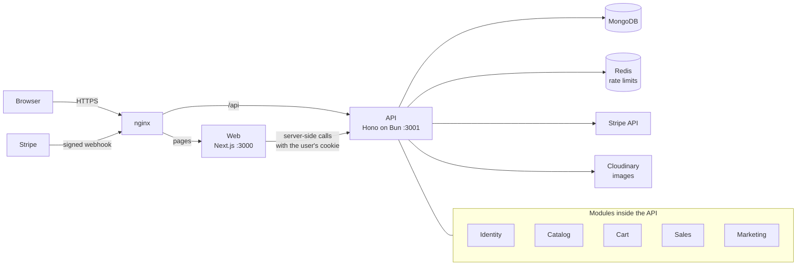
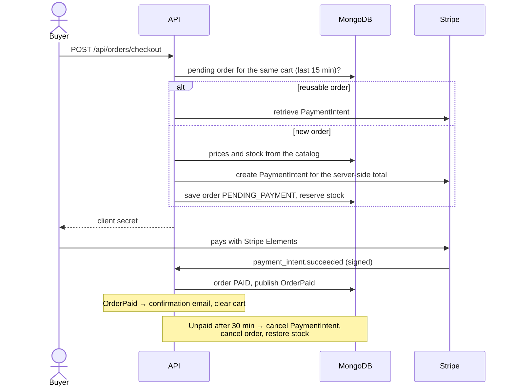

# StickerHeaven

An online sticker marketplace: artists list stickers with limited stock, buyers
add them to a cart and pay with Stripe. Built as the final project (TFC) of a
higher vocational degree in web application development, then reviewed and
hardened as a portfolio project.

**Stack:** TypeScript · Next.js 16 · React 19 · Hono on Bun · MongoDB (Mongoose) ·
Redis · Stripe · Cloudinary · Docker · nginx · GitHub Actions

## What to look at

| Area | Where |
| --- | --- |
| Modular monolith with boundaries enforced by tests | [`src/modules`](src/modules), [`tests/architecture`](tests/architecture), [ADR 0001](docs/adr/0001-modular-monolith.md) |
| Stock reserved at checkout, released if unpaid, without double restores | [`ReleaseUnpaidOrders`](src/modules/Sales/application/release-unpaid-orders/ReleaseUnpaidOrders.ts), [ADR 0003](docs/adr/0003-stock-reservation.md) |
| Stripe payments confirmed only by signed webhooks | [`StripeWebhookController`](src/modules/Sales/infrastructure/http/StripeWebhookController.ts) |
| Revocable server-side sessions, Argon2, per-IP login limit | [`Identity`](src/modules/Identity), [ADR 0002](docs/adr/0002-server-side-sessions.md) |
| Per-request CSP nonce instead of `'unsafe-inline'` | [`src/proxy.ts`](src/proxy.ts), [ADR 0005](docs/adr/0005-csp-nonce.md) |
| Production setup: nginx, healthchecks, non-root containers | [`infra/docker`](infra/docker), [`infra/nginx`](infra/nginx) |

## Architecture

Two processes from one repository ([ADR 0004](docs/adr/0004-web-and-api-processes.md)):
the Next.js web app renders pages, and the Hono API owns the domain, the data and
every secret. nginx is the only public entry point.



Each module has the same layers: `domain` (entities, value objects, repository
interfaces), `application` (one use case per folder, returning `Result`) and
`infrastructure` (Mongoose, Stripe, Cloudinary, HTTP routes). Modules reach each
other only through ports in `src/shared/contracts`; two architecture tests and
dependency-cruiser fail the build otherwise.

### Checkout and payment



## Running it locally

Requirements: [Bun](https://bun.sh) 1.3 or newer and Docker.

```bash
# MongoDB, Redis, Mailpit (email UI on :8025) and mongo-express (:8081), bound to localhost
docker compose -f infra/docker/docker-compose.yml up -d

cp .env.example .env.local   # then fill in Stripe and Cloudinary test keys
bun install
bun run seed                 # demo stickers and an admin user; prints its password

bun run dev:api              # terminal 1: API on http://localhost:3001
bun run dev:web              # terminal 2: web on http://localhost:3000
```

To receive Stripe webhooks locally, run the Stripe CLI and copy the signing
secret it prints into `STRIPE_WEBHOOK_SECRET`:

```bash
stripe listen --forward-to localhost:3001/api/orders/webhook/stripe
```

The seed refuses to run with `NODE_ENV=production`: it deletes every collection
before inserting demo data.

### Configuration

All variables are validated at startup (`src/config/envSchemas.ts`); the web
process only reads the `NEXT_PUBLIC_*` ones. See [`.env.example`](.env.example).

| Variable | Used by | Purpose |
| --- | --- | --- |
| `NEXT_PUBLIC_APP_URL`, `NEXT_PUBLIC_STRIPE_PUBLISHABLE_KEY` | web, API | Public URL and Stripe publishable key |
| `API_URL` | web | Where the web process reaches the API |
| `DATABASE_URL` | API | MongoDB connection string |
| `AUTH_SECRET` | API | Secret of at least 32 characters |
| `STRIPE_SECRET_KEY`, `STRIPE_WEBHOOK_SECRET` | API | Payments and webhook signature check |
| `CLOUDINARY_CLOUD_NAME`, `CLOUDINARY_API_KEY`, `CLOUDINARY_API_SECRET` | API | Sticker image storage |
| `ALLOWED_ORIGINS` | API | Origins allowed for CORS and cookie-carrying requests; required in production |
| `TRUST_PROXY` | API | `true` behind nginx, so the client IP comes from `X-Real-IP` |
| `REDIS_URL` | API | Shared rate-limit counters; in-memory if unset |
| `EMAIL_PROVIDER`, `SMTP_*` | API | `console` logs emails; `smtp` sends them (Mailpit in development) |

## Quality checks

```bash
bun test             # 175 tests: domain, use cases, HTTP contracts, architecture
bun run typecheck    # tsc, strict
bun run lint         # ESLint
bun run depcruise    # layer dependency rules
```

CI runs typecheck, tests, lint and `bun audit` on every pull request, and builds
the web app.

## Security

- Sessions in MongoDB behind an `httpOnly`, `SameSite=Strict` cookie; logout and
  password changes revoke them.
- Argon2 password hashing; unknown emails take the same time to reject.
- Rate limits per client IP: 150 requests per minute overall, 10 login or
  registration attempts per 15 minutes.
- Cookie-carrying unsafe requests must come from an allowed `Origin`.
- Strict CSP with a per-request nonce; HSTS in production.
- Search input is escaped before it reaches a MongoDB regex; pagination is bounded.
- Prices and totals are computed on the server; payment state only changes on
  signed Stripe webhooks.

## Production

[`infra/docker/docker-compose.prod.yml`](infra/docker/docker-compose.prod.yml)
runs nginx (TLS, the only published ports), the web and API images, MongoDB with
authentication and Redis with a password. Services wait for their dependencies'
healthchecks, and both application containers run as an unprivileged user. The
web image ships the Next.js standalone server only.

```bash
cd infra/docker
docker compose -f docker-compose.prod.yml up -d --build
```

It needs the variables above plus `MONGO_ROOT_USERNAME`, `MONGO_ROOT_PASSWORD`
and `REDIS_PASSWORD`, and TLS certificates in `infra/nginx/certs`.

## Known limitations

- Guest checkout is not implemented: buyers must log in to pay.
- No email verification, so registration can still reveal whether an email has
  an account; the per-IP limit keeps that from being probed in bulk.
- The `ADMIN` role exists in the data model but no feature uses it yet.
- The unpaid-order sweep runs in the API process; with several API instances
  each runs it (safe thanks to optimistic locking, but redundant).

## Project layout

```
src/
  app/              Next.js routes (web)
  components/       React components
  modules/          Identity, Catalog, Cart, Sales, Marketing (domain/application/infrastructure)
  shared/           Shared kernel (Result, Money, StickerId...) and cross-module contracts
  infrastructure/   Dependency container, cross-module adapters, rate limiting, logging
  server/           API composition: middlewares, routes, entry point
  proxy.ts          Per-request CSP
tests/architecture  Module boundary tests
infra/              Docker, nginx and Redis configuration
docs/adr/           Architecture decision records
```
